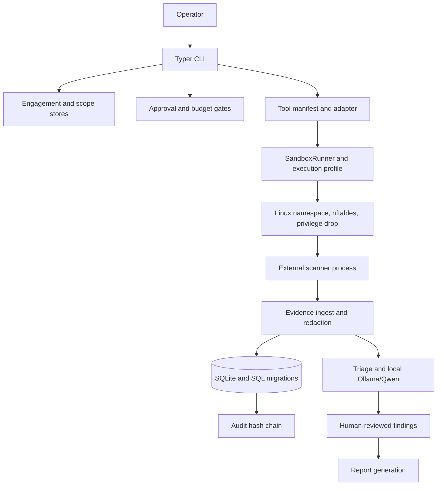
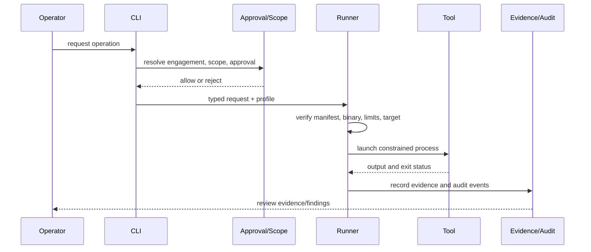

# Architecture

This document summarizes the current module structure. It is not a guarantee
that every external tool or host-specific control is installed or operational.

The CLI is defined in `src/sentinel/cli.py`. Engagement lifecycle and scope
logic live in `engagement/` and `scope/`; approval binding and budgets live in
`approval/`. Tool identity and integrity are represented by the manifest code
in `tools/`, with operation profiles and process execution in `runner/`.
Network namespace and nftables integration is in `netns/`. Evidence ingestion,
redaction, and integrity code is under `evidence/`; SQLite schema changes are
ordered under `storage/migrations/`; audit events are stored under `audit/`.
Local Ollama integration, retrieval, and triage are under `llm/`, `knowledge/`,
and `triage/`. Findings and report generation are under `findings/` and
`reporting/`.

## Trust boundaries and execution

The operator supplies authorization and exact scope. The application checks
scope, approval, tool identity, profile, and configured limits. On Linux,
namespace and nftables setup involves privileged OS operations; scanner
processes are configured to drop privileges where the current runner path
supports it. LLM traffic is intended for a local Ollama service, but local
configuration determines the actual endpoint. Evidence and database paths are
operator-managed state.

Some controls are application-level checks, while namespace, routing, process
credentials, and firewall behavior depend on OS enforcement and permissions.
Kernel-level isolation of TLS proxy upstream connections and full Class 0
unprivileged/no-network staging remain deferred. See
[EGRESS_ARCHITECTURE.md](EGRESS_ARCHITECTURE.md),
[SECURITY_MODEL.md](SECURITY_MODEL.md), and [TECHNICAL_DEBT.md](TECHNICAL_DEBT.md).

